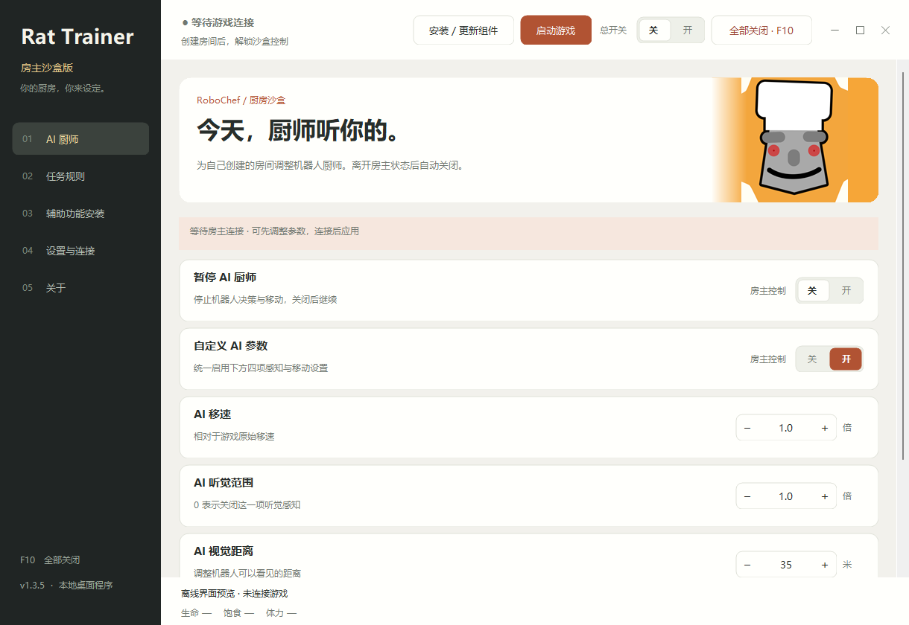
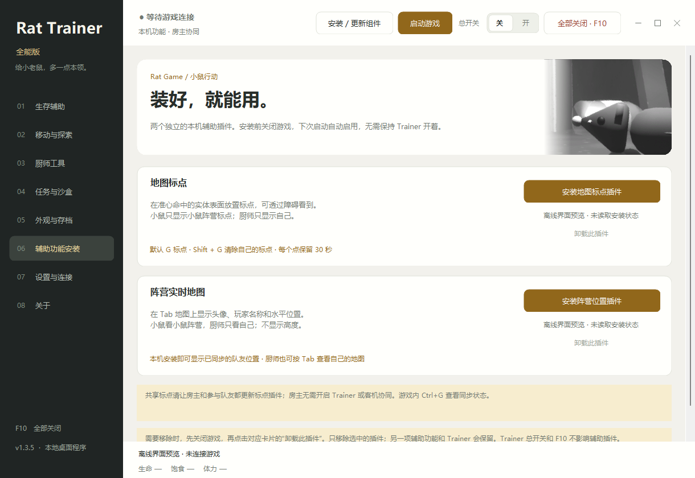
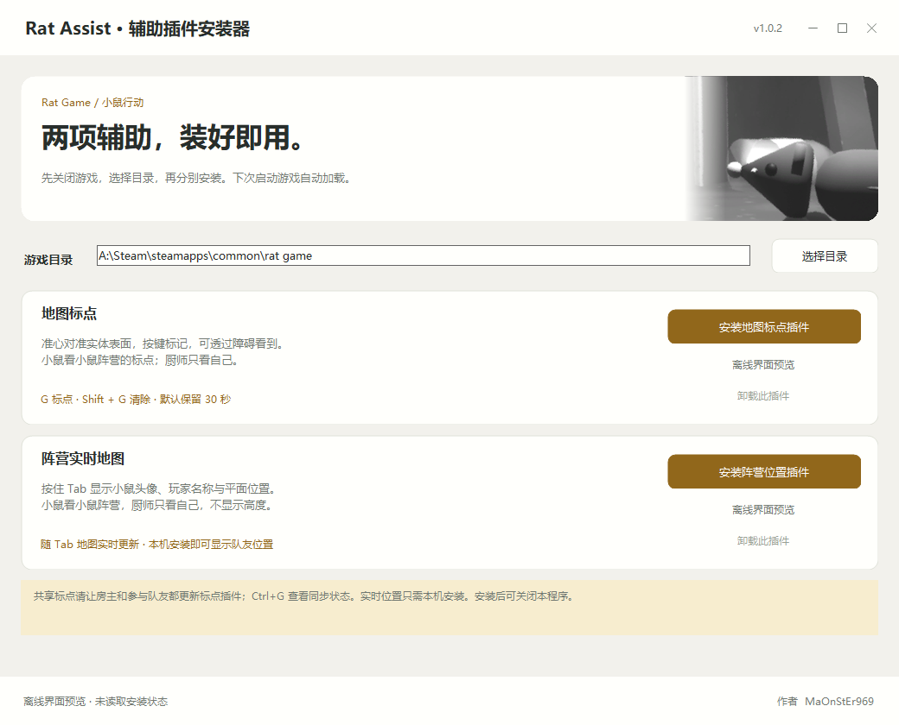

# Rat Trainer

Rat Game（小鼠行动）的 Windows 桌面工具，作者 **MaOnStEr969**。

提供房主沙盒版、全能版，以及地图标点与阵营实时地图的独立安装器。三个程序都是单文件 EXE，内置所需插件与加载器。

## 队友标点修复

当前版本修复 Steam 好友邀请房间的标点共享，并改用游戏同步时间与玩家网络编号校验。**收发双方都需要退出游戏后更新地图标点插件，再重新进房。** [查看修复与升级说明](docs/releases/v1.3.4.md)。

## 下载

[查看最新 Release](https://github.com/Maons666/RatTrainer/releases/latest)

| 应用 | 版本 | 下载 | 用途 |
| --- | --- | --- | --- |
| 房主沙盒版 | 1.3.4 | [RatTrainer-Host-v1.3.4.exe](https://github.com/Maons666/RatTrainer/releases/download/v1.3.4/RatTrainer-Host-v1.3.4.exe) | 自己房间内的 AI 厨师与任务规则，以及辅助插件管理 |
| 全能版 | 1.3.4 | [RatTrainer-All-v1.3.4.exe](https://github.com/Maons666/RatTrainer/releases/download/v1.3.4/RatTrainer-All-v1.3.4.exe) | 生存、移动、厨师、任务、外观等功能，以及辅助插件管理 |
| 辅助插件安装器 | 1.0.1 | [RatAssist-Installer-v1.0.1.exe](https://github.com/Maons666/RatTrainer/releases/download/v1.3.4/RatAssist-Installer-v1.0.1.exe) | 单独安装、更新和卸载地图标点、阵营实时地图 |

下载后可用 Release 附件 `SHA256SUMS.txt` 校验文件。普通用户只需下载所选应用的 EXE，安装、启动和卸载均可在程序内操作，无需运行命令脚本、下载仓库源码或另装 Python。

## 快速使用

1. 先关闭游戏。同一时间只打开一个 Trainer 或辅助安装器。
2. 打开所需 EXE，确认游戏目录。程序会查找 Steam 主目录和其他游戏库，也可手动选择 `Rat Game.exe`；手动选择会被记住。
3. 使用 Trainer 功能时，点击“安装 / 更新组件”，然后启动游戏，等待连接后打开总开关。
4. 只用地图标点和阵营实时地图时，在“辅助功能安装”页或独立安装器中点击对应安装按钮。安装后即可关闭桌面程序，下次启动游戏自动加载。
5. 卸载辅助插件时先关闭游戏，再点击对应卡片的“卸载此插件”。另一项辅助插件和 Trainer 会保留。

使用队友标点的玩家需要全部退出游戏，打开新版 EXE 并点击“更新地图标点插件”，然后重新进入房间。仅替换 EXE 不会更新已安装插件；新旧标点协议不互通。Trainer 游戏连接组件仍为 v1.3.0。Trainer 总开关、F10 和退出 Trainer 不会关闭独立辅助插件。

## 三个应用

### 房主沙盒版

仅包含 AI 厨师设置、任务规则、辅助插件安装、设置与连接和关于。没有无限弹药、物品生成、房主角色或客机协同开关；沙盒设置仅在自己作为房主时生效。

### 全能版

保留生存辅助、移动与探索、厨师工具、任务与沙盒、外观与存档等功能。具体功能会依据本机角色及房主权限启用，界面显示实际连接状态。

### 辅助插件独立安装器

仅安装两个辅助功能，不安装 Trainer 后端。也可识别由 Trainer 安装的辅助插件，支持分别更新和卸载。

| 功能 | 操作与可见范围 |
| --- | --- |
| 地图标点 | 默认 **G** 在准心命中的实体表面标点，**Shift + G** 清除自己的标点；默认每人最多 3 个，持续 30 秒，可透过障碍显示。 |
| 阵营实时地图 | 按住 **Tab**，使用小鼠头像与玩家名称显示 X/Z 平面位置，不显示高度。 |
| 阵营规则 | 小鼠仅显示小鼠阵营的标点和位置；厨师仅显示自己的标点和位置。幽灵角色归入小鼠阵营。 |
| 标点共享 | Steam 房间内，创建和查看标点的小鼠队友都需安装标点插件；非 Steam / LAN 房间仅显示自己的标点。 |
| 位置显示 | 只需本机安装位置插件，显示游戏已同步到本机的同阵营玩家位置。 |

## 兼容性与验证

- Windows x64，.NET Framework 4.5 或更新版本。
- 适配 **Steam Build 26403247 / Unity 6000.2.6f1 / Mono**。安装时校验游戏版本及内置文件哈希。
- 游戏安装目录需使用英文路径；桌面 EXE 可放在中文路径。
- 桌面窗口使用统一的自绘按钮与无系统标题栏布局，支持拖动、缩放、最小化和最大化。
- 本次发布通过全能版 **1520** 项、房主版 **1228** 项、独立安装器 **365** 项离线检查，包括布局、窗口和隔离目录中的安装与卸载。
- 新增 **38** 项标点同步模拟检查，覆盖邀请加入、双向收发、重复连接回调防护、重试与阵营过滤。
- 当前版本未恢复游戏内与联机运行测试，离线检查不能替代实际对局验证。

## 源码与构建

| 目录 | 内容 |
| --- | --- |
| `src/` | Trainer 游戏连接组件 |
| `assist/` | 独立辅助插件与共享逻辑 |
| `desktop/` | 两个 Trainer 的桌面界面与安装逻辑 |
| `assist-installer/` | 独立辅助插件安装器 |
| `tests/` | 离线回归与单独的游戏测试工具 |
| `docs/` | 使用说明、构建说明和截图 |
| `tools/` | 开发工具与旧命令行安装兼容脚本 |

[完整使用说明](docs/USAGE.md) · [构建与测试](docs/BUILD.md) · [本次发布说明](docs/releases/v1.3.4.md) · [游戏美术来源](desktop/assets/SOURCES.md)

源码仓库不包含游戏程序集、反编译分析文件、运行日志、个人配置或旧版 EXE。构建产物在本地 `dist/` 中生成，并通过 GitHub Release 分发。

根目录的 PowerShell 脚本用于开发者构建应用；旧的 `.cmd` 安装、启动与卸载入口已移除。测试仍需使用的旧安装逻辑保存在 `tools/legacy/`。

加载器来自官方 [BepInEx 5.4.23.6 x64](https://github.com/BepInEx/BepInEx/releases/tag/v5.4.23.6)。其依赖和游戏美术归各自权利人所有；本项目为非官方工具。

第三方许可证全文与加载器源码链接见 [THIRD-PARTY-NOTICES.txt](THIRD-PARTY-NOTICES.txt)，Release 同时提供该文件。
